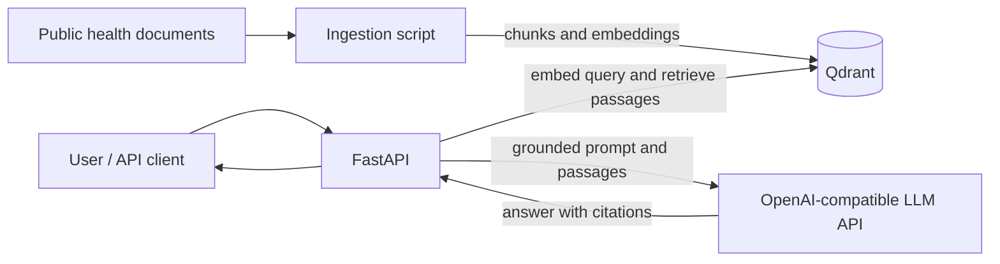

# RAG Health Assistant

A small, containerized retrieval-augmented generation (RAG) demo for answering health questions from a curated set of public health documents. The planned service retrieves relevant passages, grounds its answers in those passages, cites sources, and declines to answer when the collection does not provide enough information.

> **Project status:** Early scaffold. The repository currently contains only the initial `app` package. API endpoints, document ingestion, the corpus, Docker Compose setup, evaluation results, and tests are planned and are not yet available. This README describes the intended project; it does not claim those features are implemented.

This is a learning and portfolio project, not a medical device or a substitute for professional medical advice.

## Goals

- Answer questions using only a small, curated document collection.
- Include source citations with grounded answers.
- Refuse when retrieved material does not support an answer.
- Avoid diagnosis and treatment recommendations.
- Run the API and vector database with Docker Compose.
- Evaluate retrieval and refusal behavior with a small, inspectable question set.

## Planned architecture



The planned embedding model is `BAAI/bge-small-en-v1.5` through FastEmbed. The LLM connection will use the OpenAI Python SDK with a configurable base URL, API key, and model so it can work with compatible services such as Ollama or NVIDIA NIM. Which provider is supported will depend on the completed configuration and testing.

## Planned technology

| Area | Planned choice |
| --- | --- |
| API | FastAPI |
| Vector database | Qdrant |
| Embeddings | FastEmbed, `BAAI/bge-small-en-v1.5` |
| LLM client | OpenAI Python SDK with configurable endpoint |
| Packaging | Docker Compose |
| Tests | pytest |
| Initial sources | Public health information from MedlinePlus and WHO |

## Quick start

The containerized quick start will be documented after the API and Compose configuration are implemented. The intended workflow is:

```bash
cp .env.example .env
docker compose up --build
docker compose run --rm api python -m app.ingest
```

Once available, the API should be browsable at `http://localhost:8000/docs`. These commands are a target workflow; they do not work against the current scaffold yet.

## Planned API

| Endpoint | Purpose |
| --- | --- |
| `GET /health` | Report API health. |
| `POST /search` | Retrieve matching document chunks with scores and source metadata. |
| `POST /ask` | Return a grounded answer, citations, and a health disclaimer, or a refusal if evidence is insufficient. |

Request and response examples will be added when the API schemas are implemented.

## Planned document collection

The initial corpus is expected to contain around 15–25 public documents across four or five health topics. Documents should be accompanied by a `sources.csv` containing each title, URL, and reuse or license note. Only public materials should be used; personal patient data is out of scope. Source selection and reuse terms need to be checked before ingestion.

## Evaluation

An evaluation set is planned with answerable questions and questions that cannot be answered from the corpus. The evaluation will report retrieval hit rate at 3 and how often unanswerable questions are refused. Results will be added here after the corpus and evaluation script are implemented and run; no scores are available yet.

| Measure | Result |
| --- | --- |
| Retrieval hit rate at 3 | Not measured yet |
| Unanswerable questions refused | Not measured yet |

## Configuration

The project plans to use environment variables for service configuration. The exact variable names and defaults will be documented in `.env.example` when it is added.

| Setting | Purpose |
| --- | --- |
| LLM base URL | OpenAI-compatible chat completion endpoint. |
| LLM API key | Credential for the selected LLM service. |
| LLM model | Model identifier accepted by that service. |
| Qdrant URL | Vector database endpoint. |
| Collection name | Qdrant collection used for indexed documents. |
| Retrieval settings | Number of passages to retrieve and relevance threshold. |

Keep credentials in `.env`; do not commit secrets.

## Safety and limitations

- Answers depend on a small corpus and may omit relevant or newer information.
- Retrieval and generated answers can be incomplete or incorrect; citations should be checked against the referenced source.
- The assistant is not intended to diagnose conditions, recommend treatment, or handle emergencies.
- A refusal means the configured corpus did not provide enough support; it does not mean that no reliable information exists elsewhere.
- This project is for demonstration and educational use, not clinical decision-making.

## Development roadmap

1. Build document loading, chunking, embeddings, Qdrant indexing, and search.
2. Add grounded `/ask` responses, citations, refusal behavior, evaluation, and tests.
3. Package the API and Qdrant with Docker Compose, then document and demonstrate the working service.

## License

No repository license has been added yet. Until one is chosen, the project should not be assumed to grant reuse permissions. The license and reuse terms of each source document are separate and must be checked individually.
